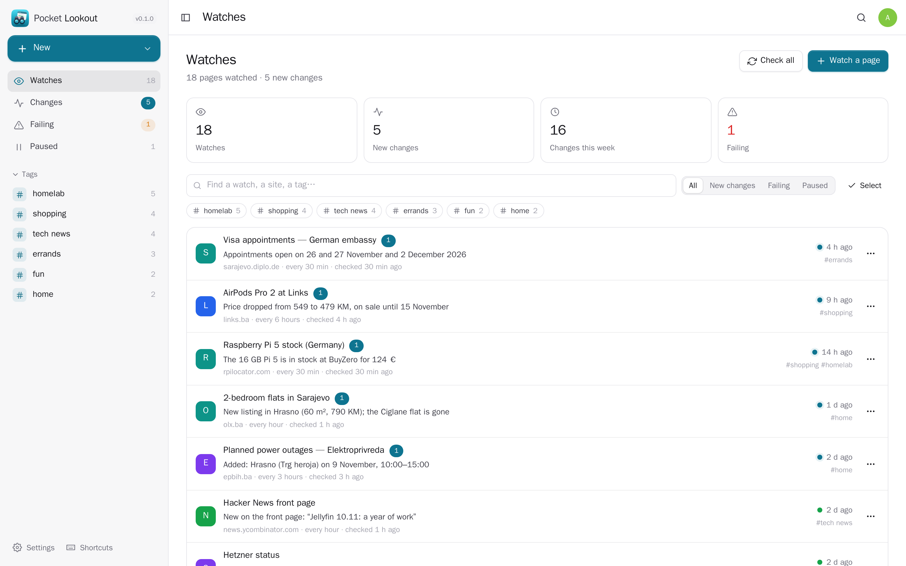
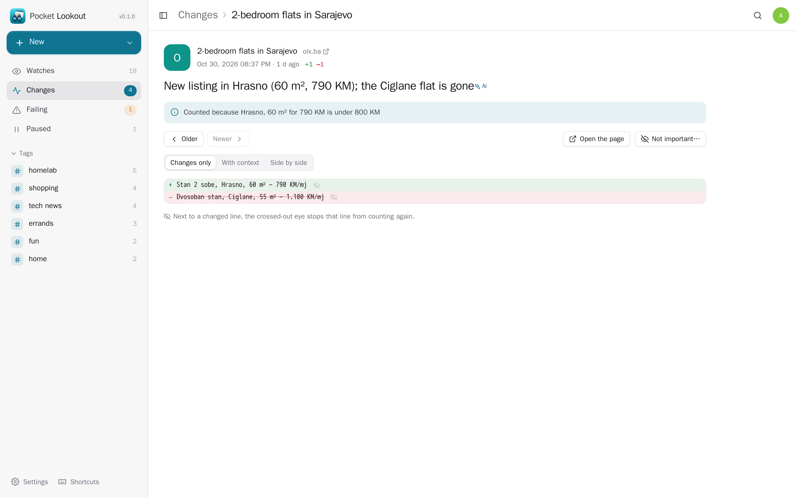
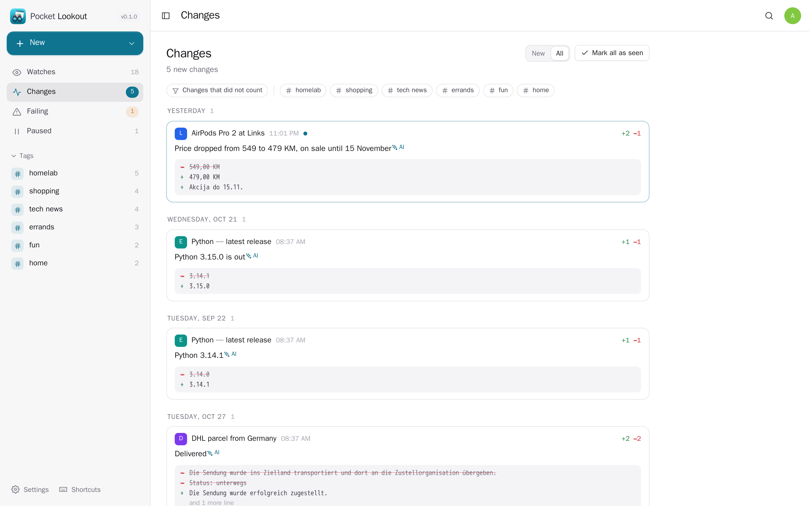
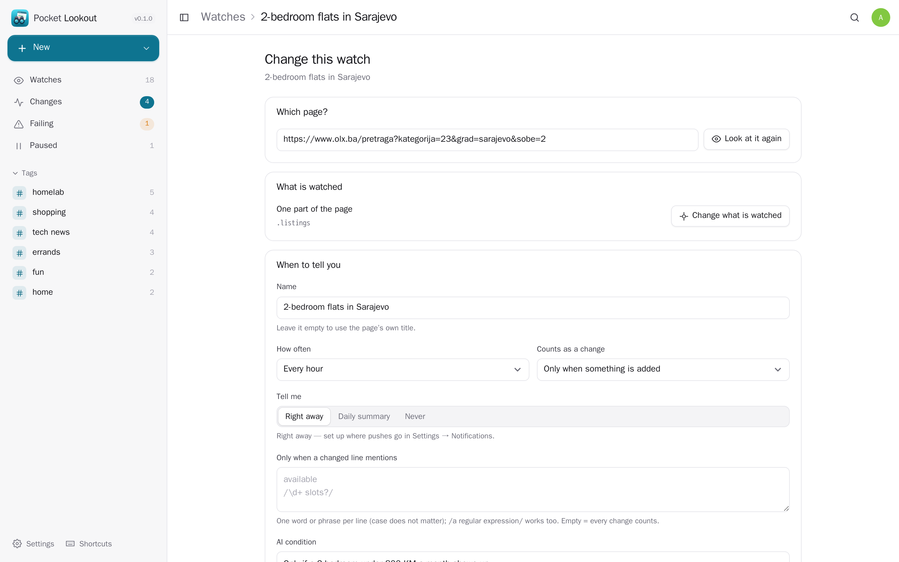
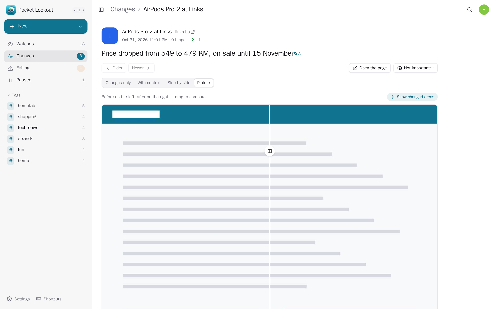
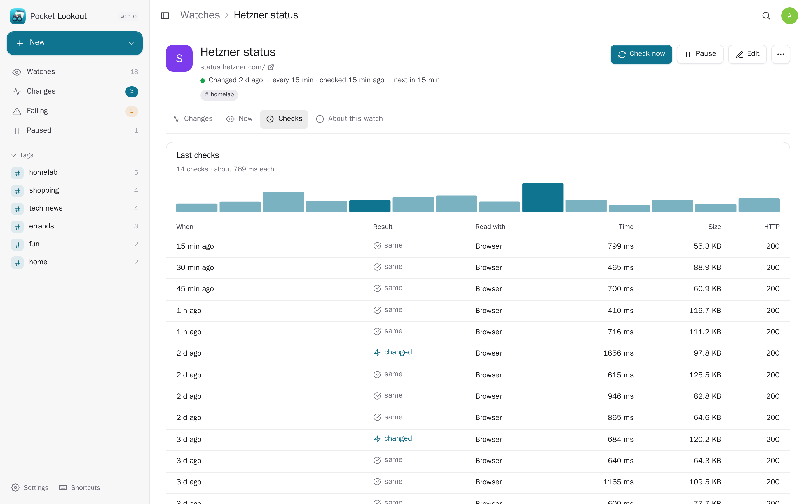
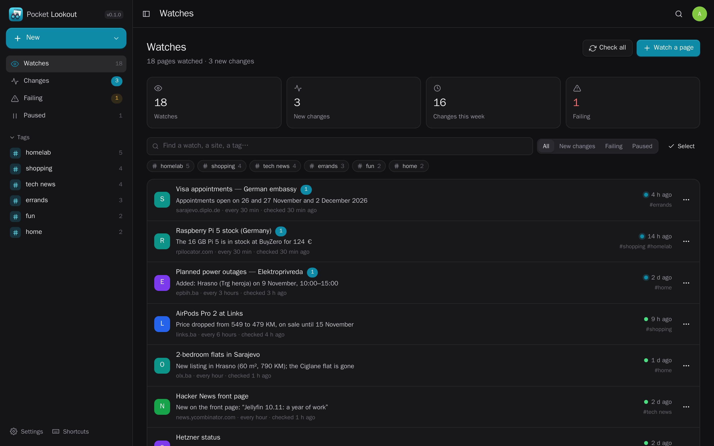
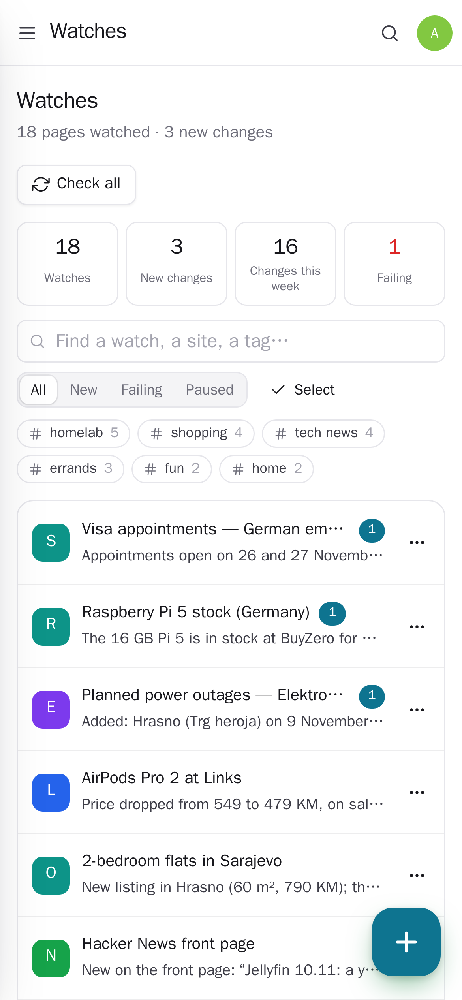
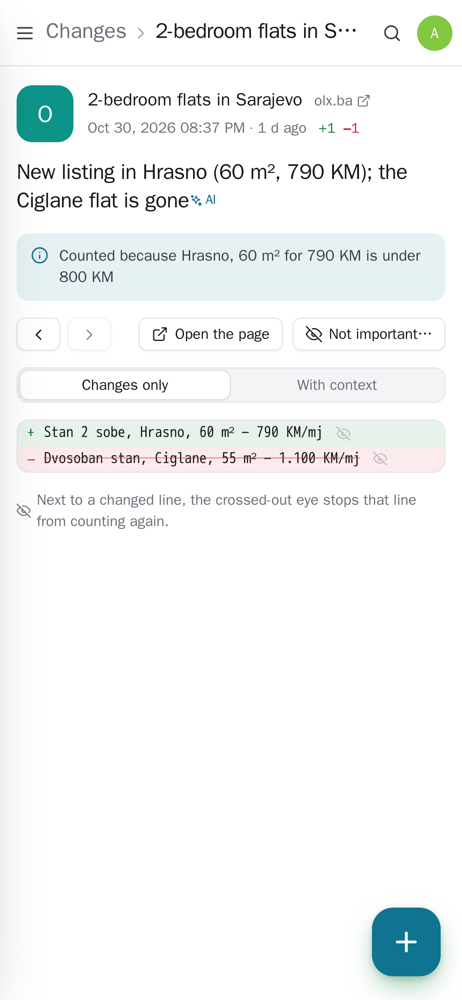
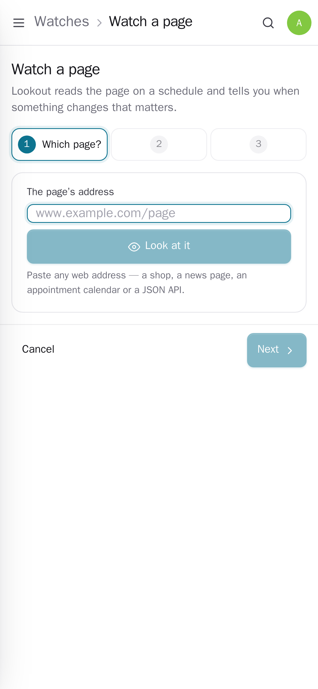

<p align="center"></p>
<h1 align="center">Pocket Lookout</h1>
<p align="center">Self-hosted change detection for web pages. Watch a whole page, one part of it (tap it, no selectors needed), a shop's price and stock, or a value in a JSON API. Dates, times and view counters that move on their own are ignored, every change gets a one-line summary, and an AI condition (“only if a 2-bedroom under 800 KM shows up”) decides whether it is worth a push. Changes reach you right away, in a daily summary, as an RSS feed or as events other Pocket apps act on.<br>One Go binary, one SQLite file, one volume. Part of the Pocket apps; works on its own too.</p>
<p align="center">
  <a href="https://github.com/abjelosevic88/pocket-homelab-lookout/actions"></a>
  <a href="https://github.com/abjelosevic88/pocket-homelab-lookout/pkgs/container/pocket-homelab-lookout"></a>
  <a href="LICENSE"></a>
</p>

---

<p align="center"></p>

<table>
  <tr>
    <td width="50%"></td>
    <td width="50%"></td>
  </tr>
  <tr>
    <td align="center"><sub>A change: the summary, why it counted, and exactly which lines came and went.</sub></td>
    <td align="center"><sub>Every change from every page, newest first, grouped by day.</sub></td>
  </tr>
  <tr>
    <td width="50%"></td>
    <td width="50%"></td>
  </tr>
  <tr>
    <td align="center"><sub>What to watch and when it counts, in plain words.</sub></td>
    <td align="center"><sub>Pages read with the browser keep a picture: drag to compare, changed areas outlined.</sub></td>
  </tr>
  <tr>
    <td width="50%"></td>
    <td width="50%"></td>
  </tr>
  <tr>
    <td align="center"><sub>Every check, how long it took and why one failed.</sub></td>
    <td align="center"><sub>Light and dark follow the system.</sub></td>
  </tr>
</table>

<p align="center">
  &nbsp;&nbsp;
  &nbsp;&nbsp;
  
</p>

- **Pick by tapping** — paste an address and Lookout shows the page's parts (headings, prices, tables, lists, anything containing the text you search for) as cards; tap one and you see exactly the text that will be compared. CSS selectors, parts to leave out, `$.json.paths` and `@price` (the price and stock a shop publishes) work too.
- **Pages that need JavaScript** — read plainly first and with a headless Chrome (sockpuppetbrowser, browserless or any DevTools endpoint) when the page is empty, says “enable JavaScript” or turns robots away; the watch remembers. The browser can keep a picture of every check.
- **Only real changes** — dates, times, “5 minutes ago” and view/like counters are masked; lines you mark “never count” (one tap on a changed line) are left out; a part that disappears is an error, not an empty page.
- **When it counts** — any change, only additions or only removals; only when a changed line mentions a word or `/pattern/`; or an AI condition in plain language, judged on the changed lines. Changes that did not count are kept with the reason.
- **Summaries** — every change gets one sentence (“Price dropped from 169 to 149 KM”), written by Pocket AI or your own OpenAI-compatible key, or plainly without one.
- **Telling you** — a push right away (Apprise, ntfy, any webhook), one daily summary at your hour, or nothing; an RSS feed for all changes and one per watch; a push when a page keeps failing and when it works again.
- **Imports** — a list of addresses, a changedetection.io backup (its zip or `url-watches.json`: URLs, titles, tags, CSS filters, ignore/trigger text, intervals, browser use) or another Lookout's export.
- Per person: everyone has their own watches and settings; admins manage accounts, not content. Keyboard shortcuts, ⌘K, phone layout, bulk actions, Homepage widget endpoint, Prometheus metrics.

## Run it

```sh
docker run -d --name pocket-lookout -p 8080:8080 -v ./data:/data \
  -e BASE_URL=https://lookout.example.com -e SECURE_COOKIES=true \
  ghcr.io/abjelosevic88/pocket-homelab-lookout:latest
```

or `docker compose up -d` with [docker-compose.yml](docker-compose.yml), which adds the headless browser. Open it, create the first account, watch a page. All options: [docs/configuration.md](docs/configuration.md). API: [docs/api.md](docs/api.md).

## With Pocket Core

Set `CORE_URL` and `CORE_REGISTRATION_KEY` and Lookout joins the box: people sign in with Pocket Core, Pocket AI writes the summaries and judges conditions with nothing to paste, and every change that counts is published as `lookout.changed` — Pocket Flows can turn it into a task, a calendar entry or anything else. Other Pocket apps can read watches and changes (`watches:read`, e.g. Pocket Day) or start watching pages (`watches:write`). Without Core everything works with your own OpenAI key; the Core-only choices stay visible, greyed out.

## Develop

```sh
make dev     # API on :8080 with demo data + Vite on :5173
make test    # go vet, go test, tsc
make         # web + binary
```

MIT licensed.
